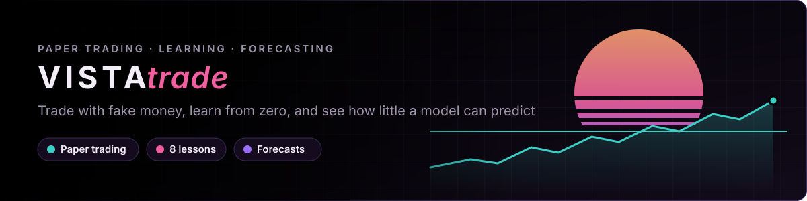
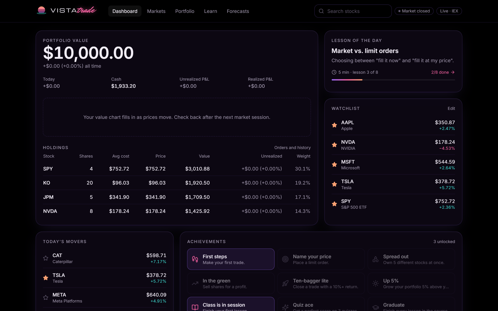
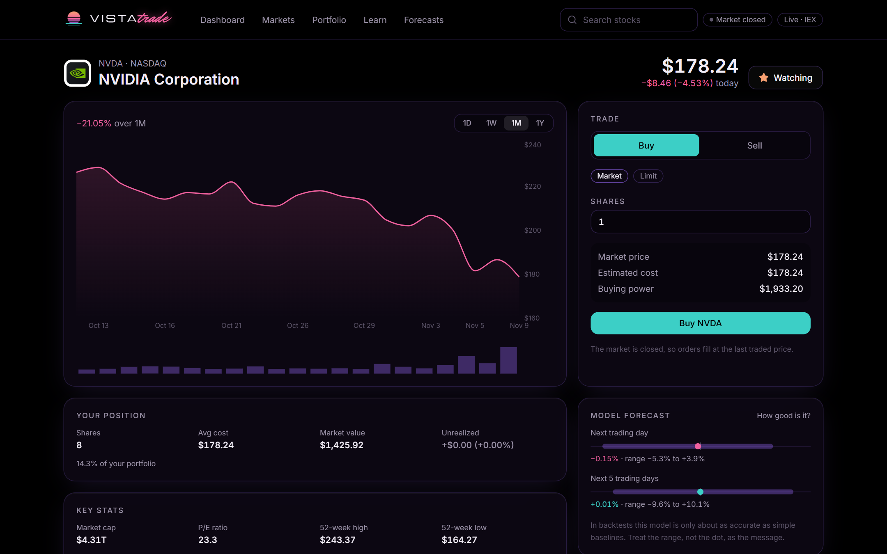
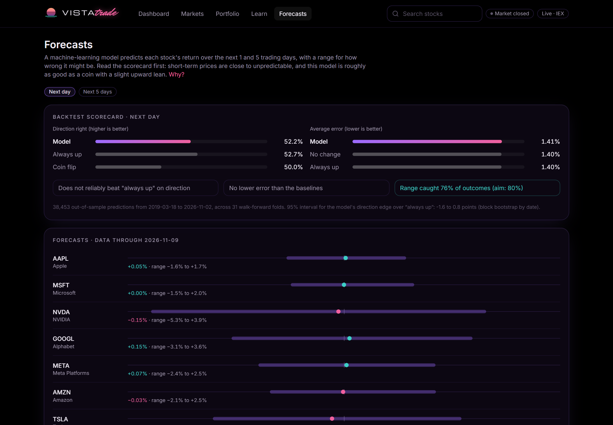
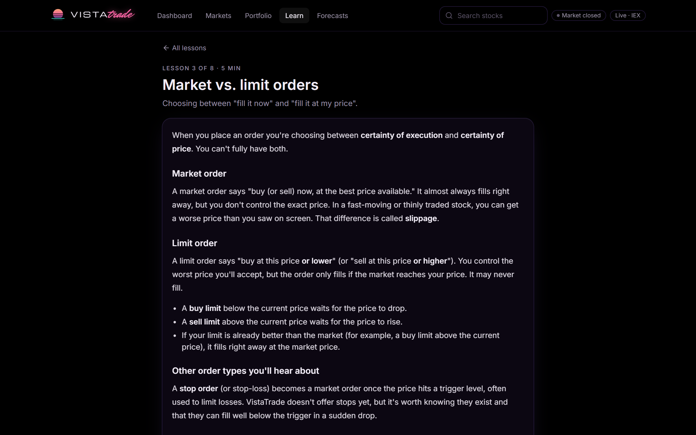
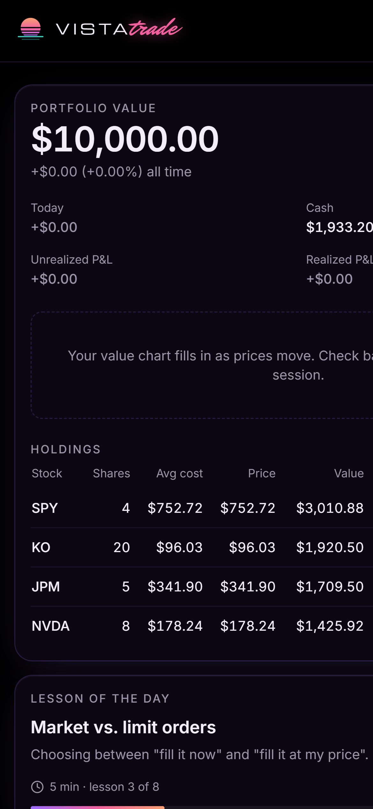
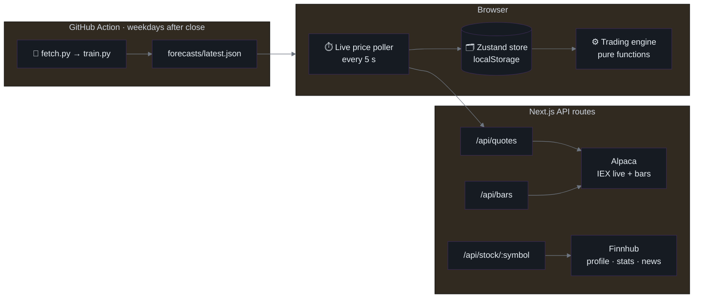
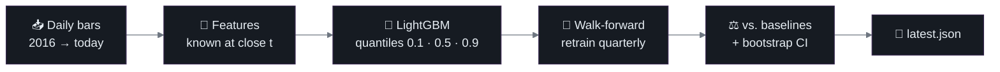

<div align="center">



<br>


[**🌐 Live demo**](https://vista-trade.vercel.app) · [**Features**](#-features) · [**Architecture**](#-architecture) · [**Model**](#-the-forecasting-model) · [**Quickstart**](#-quickstart) · [**Data sources**](#-data-sources) · [**Disclaimer**](#%EF%B8%8F-disclaimer)

</div>

---

## 🎯 Overview

VistaTrade is a **paper-trading and learning platform**: trade real US stocks with $10,000 of virtual money, learn the basics in short lessons that use your own paper account, and see what a machine-learning model can (and mostly can't) predict about next week's prices.

| | |
|---|---|
| **Problem** | Beginners either learn with real money or with toy simulators that teach nothing about how markets actually behave. |
| **Goal** | A realistic, free sandbox with live prices, honest mechanics and a course that ties every concept to something you can try. |
| **The twist** | A forecasting model that is always shown next to simple baselines and its own backtest, to teach how little short-term prices can be predicted. |
| **Live** | [vista-trade.vercel.app](https://vista-trade.vercel.app) · deployed on Vercel, redeploys on every push |
| **Built by** | [Frank Ponce](https://github.com/FrankPonce) · [frankponce.dev](https://frankponce.dev) |
| **Stack** | Next.js 15 · React 19 · TypeScript · Tailwind · Zustand · Recharts · Python · LightGBM · GitHub Actions |

> [!IMPORTANT]
> **Educational only. Not financial advice.** All money is virtual and no real orders are ever placed.

| Dashboard | Stock page |
|---|---|
|  |  |
| **Forecasts** | **Lesson** |
|  |  |

<details>
<summary><b>Mobile</b></summary>
<br>

</details>

<sub>Real market data (Alpaca IEX + Finnhub), taken after the close on 9 Nov 2026 with a demo paper account.</sub>

---

## ✨ Features

| Area | What you can do |
|---|---|
| 💸 **Paper trading** | Market and limit orders · open orders that reserve cash or shares · cancel · order history · positions with average cost · realised and unrealised P&L · portfolio value over time · reset |
| 📈 **Markets** | 20 popular stocks and ETFs by sector · search across every US-listed stock · watchlist · today's movers |
| 🔎 **Stock pages** | Live price · 1D / 1W / 1M / 1Y chart with volume · key stats · news · your position · the model's forecast |
| 🎓 **Learn** | 8 five-minute lessons from zero, each with a quiz and a "try it" task checked against your paper account |
| 🏆 **Achievements** | 10 badges for trading and learning milestones (first trade, limit order, diversification, graduate…) |
| 🔮 **Forecasts** | 1-day and 5-day return forecasts with an 80% range, next to baselines and a walk-forward scorecard |

<details>
<summary><b>The course</b></summary>

| # | Lesson | Try it |
|:-:|---|---|
| 01 | What is a stock? | Build your watchlist |
| 02 | How prices move | Make your first trade |
| 03 | Market vs. limit orders | Place a limit order |
| 04 | Diversification | Hold 3 sectors at once |
| 05 | Risk and position sizing | Keep every position under 40% |
| 06 | Reading a price chart | Switch a chart to 1Y |
| 07 | Common beginner mistakes | Sell on purpose, not on impulse |
| 08 | What can a model predict? | Compare the model to its baselines |

Claims worth double-checking are tracked in [`docs/CONTENT_REVIEW.md`](docs/CONTENT_REVIEW.md).
</details>

---

## 🧱 Architecture



- **API keys never reach the browser.** Every provider call lives in `src/lib/market/*`, marked `server-only`.
- **No keys? It still runs.** A deterministic simulated market takes over and every page says so.
- **One request for all prices.** The poller asks for every symbol at once; responses are CDN-cacheable for 4 seconds, so visitors share upstream calls. Works on serverless hosting with no long-lived connections.
- **Trading rules are pure and tested.** [`engine.ts`](src/lib/trading/engine.ts) takes an account and returns a new one; [`engine.test.ts`](src/lib/trading/engine.test.ts) covers fills, limits, reservations and P&L.

> [!NOTE]
> Simplifications vs. a real broker: fills use the last trade price with no spread, slippage or fees; whole shares only; no shorting; orders can fill outside market hours at the last price.

---

## 🔮 The forecasting model

**Question:** how much better than a trivial rule can a reasonable model forecast daily stock returns?



| | |
|---|---|
| **Data** | Daily split- and dividend-adjusted bars for 20 symbols since 2016 (Alpaca, full-market SIP) |
| **Features** | Returns over 1/2/5/10/20 days · 5/20-day volatility · volume vs. 20-day average · RSI-14 · distance from 20/50-day MA · daily range · SPY return and volatility · day of week |
| **Targets** | Log return from close *t* to close *t+1* and *t+5* |
| **Model** | One pooled LightGBM per horizon with quantile loss: median = forecast, 10th–90th percentile = uncertainty range |
| **Backtest** | Train on ~3 years, predict the next quarter, roll forward, retrain. An *h*-day embargo stops overlapping targets from leaking |
| **Baselines** | *No change* (predict 0%) and *always up* (predict the average training return), scored on the same rows |
| **Uncertainty** | 95% interval for the direction edge via block bootstrap over dates (stocks move together; 5-day targets overlap) |

### Results

**Real data: 20 US stocks and ETFs, out-of-sample from Mar 2019 to Nov 2026.**

| Horizon | Model direction | Always up | Edge 95% CI | Model MAE | No-change MAE | Always-up MAE | 10–90% coverage |
|:-:|:-:|:-:|:-:|:-:|:-:|:-:|:-:|
| 1 day | 52.2% | **52.7%** | −1.6 to +0.8 pts | 1.41% | 1.40% | **1.40%** | 75.9% |
| 5 days | 53.9% | **55.4%** | −2.8 to −0.5 pts | 3.25% | 3.23% | **3.21%** | 74.7% |

<sub>38,453 out-of-sample predictions per horizon · 31 walk-forward folds · data through 2026-11-09 · full output in <a href="ml/results/backtest.json"><code>ml/results/backtest.json</code></a></sub>

> [!IMPORTANT]
> **The model does not beat the trivial baselines.** On next-day direction it is statistically indistinguishable from "always up"; over 5 days it is measurably *worse* (the whole interval is below zero), because it sometimes predicts "down" in a market that mostly went up. Its average error is a hair worse than predicting no change. The uncertainty range is slightly too narrow, catching about 75% of outcomes instead of 80%.
>
> That is the expected result for public daily price features, and it's the point of the page: a well-built, leak-free model with honest evaluation shows how little short-term price data predicts.

**Leakage check: synthetic random-walk prices.** On data that is unpredictable by construction, the model must not beat the baselines. It doesn't, so nothing is leaking. (Run with `python train.py --synthetic`.)

| Horizon | Model direction | Always up | Edge 95% CI | Model MAE | No-change MAE | 10–90% coverage |
|:-:|:-:|:-:|:-:|:-:|:-:|:-:|
| 1 day | 49.7% | 51.1% | −2.9 to +0.2 pts | 1.32% | 1.31% | 78.5% |
| 5 days | 50.7% | 52.1% | −4.0 to +0.8 pts | 3.13% | 3.09% | 77.9% |

<sub>40,537 out-of-sample predictions · Feb 2019 → Nov 2026 · 33 walk-forward folds</sub>

---

## ⚡ Quickstart

**Web app** (needs [Node.js](https://nodejs.org) 20+)

```bash
npm install
cp .env.example .env.local     # optional: add API keys for real data
npm run dev                    # http://localhost:3000
npm test                       # trading engine tests
```

**Forecasting pipeline** (needs Python 3.12)

```bash
cd ml
python -m venv .venv
.venv\Scripts\activate             # macOS/Linux: source .venv/bin/activate
pip install -r requirements.txt
python train.py --synthetic        # leakage check, no keys needed
python fetch.py && python train.py # real data, needs ALPACA_KEY_ID / ALPACA_SECRET_KEY
```

**Environment variables** (all server-only, see [`.env.example`](.env.example))

| Variable | Where to get it | Used for |
|---|---|---|
| `ALPACA_KEY_ID` · `ALPACA_SECRET_KEY` | [Alpaca](https://app.alpaca.markets) → Paper account → API Keys | Prices, charts, search, model data |
| `FINNHUB_API_KEY` | [Finnhub dashboard](https://finnhub.io/dashboard) | Company stats and news |

The [daily workflow](.github/workflows/forecasts.yml) needs the two Alpaca keys as repository secrets.

---

## 📁 Repository map

```text
├── src/
│   ├── app/                  pages: dashboard · markets · stocks/[symbol] · portfolio · learn · forecasts · about
│   │   └── api/              quotes · bars · search · stock/[symbol]  (server-side provider calls)
│   ├── components/           charts · order ticket · tables · nav · logo · toasts
│   └── lib/
│       ├── market/           alpaca · finnhub · simulated · index (picks a source)
│       ├── trading/          paper-trading engine + tests
│       ├── learn/            course content and types
│       ├── store.ts          saved state (Zustand + localStorage)
│       └── achievements.ts   badge rules
├── ml/
│   ├── fetch.py              download daily history from Alpaca
│   ├── features.py           leakage-safe features and targets
│   ├── train.py              walk-forward backtest + today's forecasts
│   └── results/              backtest summaries
├── public/forecasts/         latest.json, read by the app
├── .github/workflows/        daily forecast refresh
├── docs/                     screenshots · content review
└── assets/                   banner
```

---

## 🗄️ Data sources

| Source | Used for | Terms |
|---|---|---|
| [Alpaca Market Data](https://docs.alpaca.markets/docs/about-market-data-api) · free plan | Live prices (IEX exchange only), historical bars, symbol list, training data | Free account required. Live data is a single exchange, so prices can differ slightly from the consolidated market. Check Alpaca's terms before any commercial use or redistribution. |
| [Finnhub](https://finnhub.io) · free plan | Company profile, key stats, news | Personal, non-commercial use. |
| Simulated market | Fallback when no keys are set | Generated in [`simulated.ts`](src/lib/market/simulated.ts), clearly labelled. |

Market data remains the property of its providers and exchanges.

---

## ⚠️ Disclaimer

VistaTrade is an educational project. It is **not** investment, financial, tax or legal advice, and nothing here is a recommendation to buy or sell any security. Paper-trading results ignore spreads, slippage, fees and taxes, and don't reflect the emotions of trading real money. Forecasts are an experiment in how little a model can know. Past performance, real or simulated, doesn't predict future results.

<div align="center">
<br>
<sub>Built by Frank Ponce · <a href="https://frankponce.dev">frankponce.dev</a></sub>
</div>
