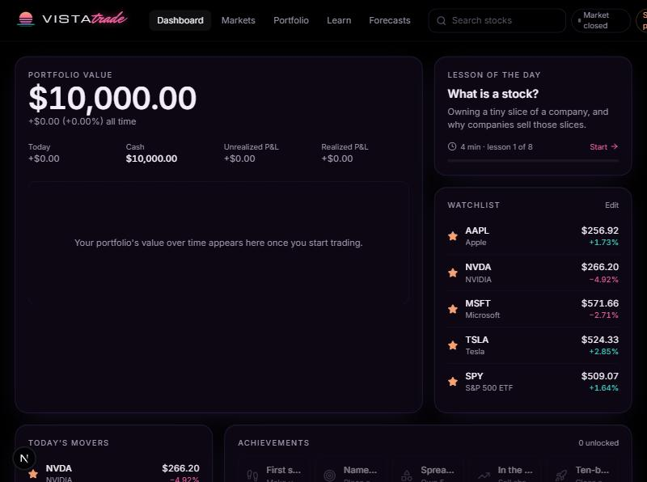
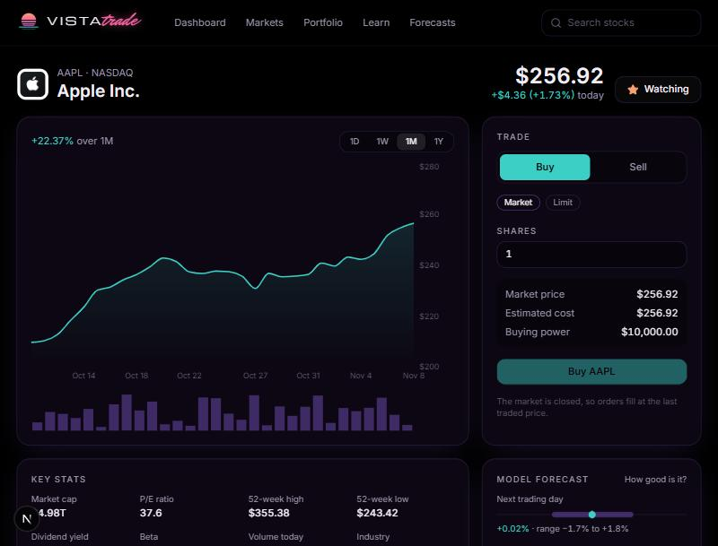
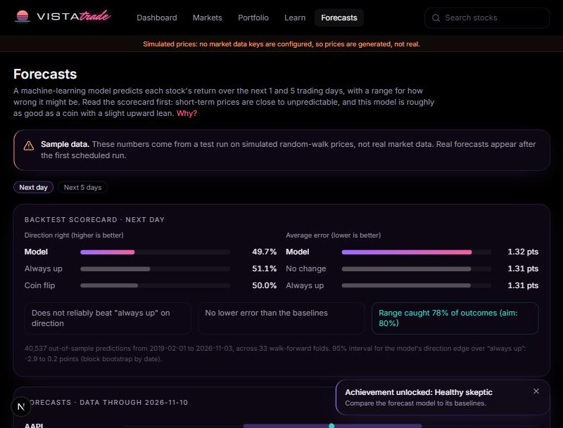
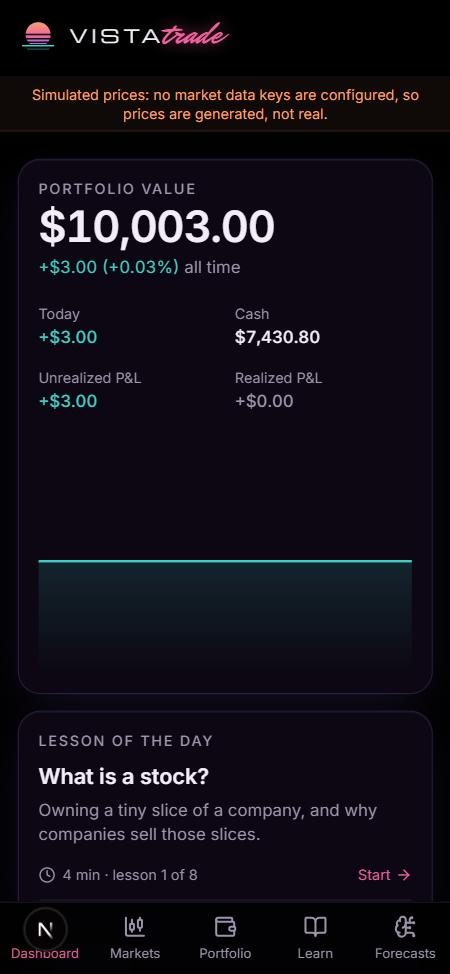

# VistaTrade

**Paper trading, a beginner course, and an honest forecasting experiment.** Virtual money, real market data, Miami-at-night glass UI.

> **Educational only. Not financial advice.** All money is virtual; no real orders are placed. Forecasts exist to show how little a model can predict, not to tell anyone what to buy.

| Dashboard | Stock page |
| --- | --- |
|  |  |
| **Forecasts** | **Mobile** |
|  |  |

<sub>Screenshots taken in simulated-data mode (no market data keys configured).</sub>

## What it does

- **Paper trading.** $10,000 of virtual cash. Market and limit orders, open orders that reserve cash/shares, order history, positions with average cost, realised and unrealised P&L, portfolio value over time, and a reset button. Saved per browser in `localStorage`.
- **Markets.** 20 popular stocks and ETFs plus search across every US-listed stock. Each stock has a live price, 1D/1W/1M/1Y chart with volume, key stats, news, your position and the model's forecast.
- **Learn.** Eight five-minute lessons from zero (what a stock is → what a model can predict), each with a quiz and a "try it" task checked against your paper account. Progress feeds into ten achievements.
- **Forecasts.** A LightGBM model forecasts 1-day and 5-day returns with an 80% uncertainty range, shown next to two baselines and its own walk-forward backtest.

## Architecture

```
Browser (React, Zustand)                    Next.js server (API routes)            Providers
───────────────────────                    ───────────────────────────            ─────────
LivePrices poller ── every 5s ──────────▶  /api/quotes   ── one batched call ──▶  Alpaca (IEX live prices)
PriceChart        ─────────────────────▶   /api/bars     ─────────────────────▶   Alpaca (historical bars)
SymbolSearch      ─────────────────────▶   /api/search   ─────────────────────▶   Alpaca (asset list, cached 24h)
StockView         ─────────────────────▶   /api/stock/X  ─────────────────────▶   Finnhub (profile, stats, news)
Forecasts page    ── static file ──────▶   /forecasts/latest.json  ◀── GitHub Action (daily) ◀── ml/ (Python)
```

- **API keys never reach the browser.** Every provider call happens in `src/lib/market/*` (marked `server-only`). With no keys set, the app runs on a deterministic simulated market and says so on every page.
- **The trading rules are pure functions** in [`src/lib/trading/engine.ts`](src/lib/trading/engine.ts) with unit tests in `engine.test.ts`. State and persistence live separately in [`src/lib/store.ts`](src/lib/store.ts).
- **Live prices** are polled, not streamed: one request every 5 seconds fetches every symbol the app needs, and responses are CDN-cacheable for 4 seconds, so many visitors share the same upstream call. This works on serverless hosting (no long-lived connections).

```
src/
  app/                 pages (dashboard, markets, stocks/[symbol], portfolio, learn, forecasts, about) + api/
  components/          UI building blocks (charts, order ticket, tables, nav, logo)
  lib/market/          data providers: alpaca.ts, finnhub.ts, simulated.ts, index.ts (picks one)
  lib/trading/         paper-trading engine + tests
  lib/learn/           course content (lessons.ts)
  lib/store.ts         saved state (Zustand + localStorage)
ml/                    forecasting pipeline (Python)
.github/workflows/     daily forecast refresh
```

## The forecasting model

**Goal:** show, with real numbers, how much (or how little) a model can know about short-term prices.

- **Data:** daily split- and dividend-adjusted bars since 2016 for the 20 tracked symbols (Alpaca, full-market SIP feed).
- **Features** (all known at the close of day *t*): past log returns over 1/2/5/10/20 days, 5- and 20-day volatility, volume vs. its 20-day average, RSI-14, distance from 20/50-day moving averages, daily range, SPY's 1/5-day return and volatility, day of week.
- **Targets:** log return from the close of *t* to the close of *t+1* and *t+5*.
- **Model:** one pooled LightGBM model per horizon with quantile loss: the median (0.5) is the forecast, 0.1 and 0.9 form the uncertainty range.
- **Backtest:** walk-forward. Train on the first ~3 years, predict the next quarter, roll forward, retrain, repeat. An *h*-day embargo between the training and test periods stops overlapping targets from leaking.
- **Baselines** scored on exactly the same rows: *no change* (predict 0%) and *always up* (predict the average training return).
- **Honest uncertainty:** the model's direction edge over "always up" gets a 95% interval from a block bootstrap over dates, because stocks move together on the same day and 5-day targets overlap.

### Results

**Real-data results:** not available yet. They appear in `ml/results/backtest.json` and on the Forecasts page after the first run with Alpaca keys (locally or via the GitHub Action). *Update this section with those numbers.*

**Leakage check (synthetic random-walk prices):** on data that's unpredictable by construction, the model must not beat the baselines. It doesn't:

| Horizon | Model direction | "Always up" | Edge 95% CI | Model MAE | "No change" MAE | 10-90% range coverage |
| --- | --- | --- | --- | --- | --- | --- |
| 1 day | 49.7% | 51.1% | −2.9 to +0.2 pts | 1.32% | 1.31% | 78.5% |
| 5 days | 50.7% | 52.1% | −4.0 to +0.8 pts | 3.13% | 3.09% | 77.9% |

40,537 out-of-sample predictions from 2019-02 to 2026-11, 33 folds. Expect real-data results to look similar: close to the baselines, with a well-calibrated range.

### Run it

```bash
cd ml
python -m venv .venv && .venv/Scripts/activate   # macOS/Linux: source .venv/bin/activate
pip install -r requirements.txt
python train.py --synthetic        # leakage check, no keys needed
python fetch.py && python train.py # real data (needs ALPACA_KEY_ID / ALPACA_SECRET_KEY)
```

The [daily workflow](.github/workflows/forecasts.yml) runs `fetch.py` and `train.py` after each US close and commits `public/forecasts/latest.json`. That push triggers a redeploy, which serves the new file.

## Run locally

```bash
npm install
cp .env.example .env.local   # optional: add keys for real data
npm run dev                  # http://localhost:3000
npm test                     # trading engine tests
```

## Data sources and licences

| Source | Used for | Terms |
| --- | --- | --- |
| [Alpaca Market Data](https://docs.alpaca.markets/docs/about-market-data-api), free plan | Live prices (IEX exchange only), historical bars, symbol list, model training data | Requires a free Alpaca account. Free-plan live data covers IEX only, so it can differ slightly from the consolidated price. Check Alpaca's terms before any commercial use or redistribution. |
| [Finnhub](https://finnhub.io), free plan | Company profile, key stats, news | Free plan is for personal, non-commercial use. |
| Simulated market (`src/lib/market/simulated.ts`) | Fallback when no keys are set | Generated data, clearly labelled. |

Market data remains the property of its providers and exchanges.

## Tech

Next.js 15 (App Router) · React 19 · TypeScript · Tailwind CSS 3 · Recharts · Zustand · Vitest · Python 3.12 · pandas · LightGBM · GitHub Actions

## Disclaimer

VistaTrade is an educational project. It is not investment, financial, tax or legal advice. Paper-trading results ignore spreads, slippage, fees and taxes, and don't reflect the emotions of trading real money. Past performance, real or simulated, doesn't predict future results.
